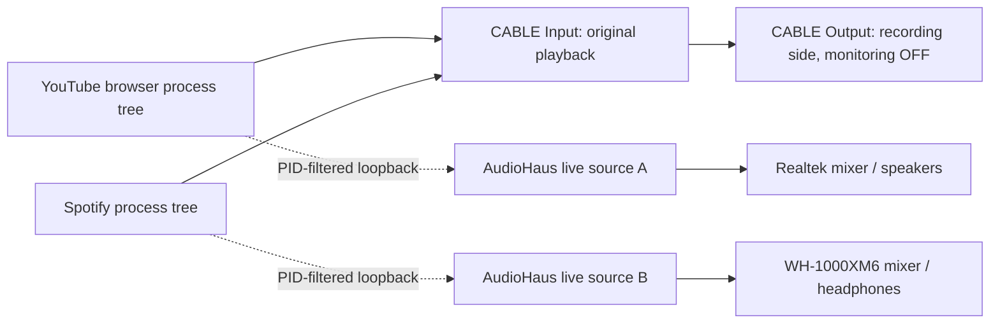

# Application capture and virtual-cable setup

AudioHaus can capture a selected application process tree and route it through
the same mixers as local files. This supports a browser playing YouTube to
Realtek and Spotify to WH-1000XM6, or two independent VLC processes playing
different songs. Capture is by PID/tree, not by executable name or browser tab.

## Why the cable is required

Process loopback copies rendered audio and leaves the application's original
playback path running. Muting AudioHaus alone cannot silence that original path.
For this MVP, send the originals to a silent virtual playback endpoint, then send
the captured copies to the intended physical outputs.



The recording side of the cable is not captured by AudioHaus. Capturing that
aggregate would combine both applications. A single cable can park both apps
because Windows process loopback separates their process trees independently
of the endpoint.

Microsoft documents this behavior and process-tree selection in its
[application-loopback sample](https://learn.microsoft.com/en-us/samples/microsoft/windows-classic-samples/applicationloopbackaudio-sample/).
This project targets Windows 11 x64; this process-loopback API requires Windows
build 20348 or later. Protected content can be unavailable to capture; the MVP
does not bypass content protection.

## Install and configure the cable

1. Download the Windows package from the official
   [VB-CABLE page](https://vb-audio.com/Cable/). Extract it and run
   `VBCABLE_Setup_x64.exe` as administrator. Click **Install Driver**, then restart
   Windows as required by the vendor. AudioHaus does not restart the PC.
2. After restarting, retain Realtek or your headphones as the normal Windows
   default output. Installation can change device selections; check them again.
3. Start audio in each source application so it appears in Windows Volume mixer.
   Open **Settings → System → Sound → Volume mixer**, expand each application,
   and select **CABLE Input (VB-Audio Virtual Cable)** as its output. An app may
   need playback restarted to adopt its new destination.
4. Keep the application and its Windows session unmuted. Use AudioHaus route
   gain/mute for monitoring control. Keep the cable playback device enabled.
5. In the recording-device properties for **CABLE Output**, disable **Listen to
   this device**. Close other applications that monitor the cable to speakers.
   Otherwise the originals can still become audible through that separate path.
   To find both settings in the classic panel, press **Win+R**, enter
   `mmsys.cpl`, and press Enter. On **Playback**, select WH-1000XM6 or Realtek,
   then **Set Default → Apply**. On **Recording**, select **CABLE Output →
   Properties → Listen**, clear **Listen to this device**, and apply the change.
6. With AudioHaus closed, play both apps. Neither should be audible on the
   physical outputs. This is the essential check that the parking path is silent.
7. Build AudioHaus and run:

```powershell
$diagnostics = '.\artifacts\bin\x64\Release\AudioHaus.Diagnostics\AudioHaus.Diagnostics.exe'
& $diagnostics cable-setup
& $diagnostics applications
& $diagnostics processes Spotify
& $diagnostics processes msedge
& $diagnostics list
```

`cable-setup` displays active endpoints with standard VB-CABLE playback names.
This name check is a setup hint; it cannot prove driver identity or disabled
monitoring. `applications` shows active session PIDs and actual output IDs.
Paused/idle applications may be absent; `processes <name>` also lists idle
processes. Names omit `.exe`.

The official Pack45 package has been prepared locally at
`artifacts/VirtualCable/Driver/VBCABLE_Setup_x64.exe`. On this PC, Authenticode
reported Valid for the installer (BUREL VINCENT Entrepreneur individuel) and the
Windows 10 x64 driver catalog (Microsoft Windows Hardware Compatibility
Publisher). The observed ZIP SHA-256 is
`B950E39F01AF1D04EA623C8F6D8EB9B6EA5C477C637295FABF20631C85116BFB`.
This records the downloaded artifact, rather than a vendor-published checksum.
Downloaded third-party binaries remain under ignored build artifacts.

## Route YouTube and Spotify

Keep YouTube in a browser process tree separate from Spotify. Selecting a browser
root includes its child audio processes and may include every tab/window in that
tree. A new browser window alone does not ensure a separate process tree. If
Spotify also runs in the same browser tree, use its desktop app or a separate
browser process tree for independent routing.

Start the routing console:

```powershell
& $diagnostics route
```

Enter these commands, replacing placeholders with current IDs/PIDs:

```text
capture <browser-root-pid> "<CABLE-Input-endpoint-id>"
capture <spotify-root-pid> "<CABLE-Input-endpoint-id>"
output "<Realtek-endpoint-id>"
output "<WH-1000XM6-endpoint-id>"
connect <browser-source-id> <Realtek-output-id> 0.15
connect <spotify-source-id> <headphone-output-id> 0.15
play all
status
```

Each capture/output command prints an ID. Use those values; IDs are not PIDs and
need not be consecutive. A capture opens with its AudioHaus monitor stopped;
the source application can already be playing silently into the cable.

Existing route commands work for captured sources, including fan-out, mixing,
per-route gain/mute, disconnect, and removal. `pause` and `stop` affect AudioHaus
monitoring only. They do not pause the application. `play` resumes at live audio,
without replaying a paused backlog. Live sources cannot seek; use the source
application's transport. Their source duration is zero, denoting a live stream.

## Two VLC instances

VideoLAN documents [multiple VLC instances](https://docs.videolan.me/vlc-user/desktop/3.0/en/advanced/player/play_multiple_instances),
including the `--no-one-instance` option. With VLC already installed, for example:

```powershell
$vlc = 'C:\Program Files\VideoLAN\VLC\vlc.exe'
& $vlc --no-one-instance 'C:\Users\Legion\Music\Kendrick Lamar - HUMBLE..mp3'
& $vlc --no-one-instance 'C:\Users\Legion\Music\Bedroom - In My head.m4a'
& $diagnostics processes vlc
```

Open each instance separately if your shell waits for a player to close. Confirm
two different VLC PIDs, and send both instances' original playback to CABLE Input
using their audio-device selection or Windows Volume mixer. Both may share the
same cable. Capture each PID separately, then connect its source to a different
physical output using the commands above. Do not select two tracks within a
single VLC process when you want separate process captures.

## Managed API

```csharp
using var router = AudioRouter.Create();
uint browser = router.AddProcessSource(browserPid, cablePlaybackEndpointId);
uint spotify = router.AddProcessSource(spotifyPid, cablePlaybackEndpointId);
uint speakers = router.AddOutput(realtekEndpointId);
uint headphones = router.AddOutput(headphoneEndpointId);
router.Connect(browser, speakers, gain: 0.15);
router.Connect(spotify, headphones, gain: 0.15);
router.Play(browser);
router.Play(spotify);
ProcessCaptureStatus capture = router.GetCaptureStatus(browser);
```

The API requires the caller to supply a genuinely silent virtual parking output.
The diagnostics console restricts its setup selection to standard cable playback
names; the native API also accepts other render endpoints for diagnostic probes.
A physical parking endpoint leaves original playback audible and cannot establish
the no-duplicates checkpoint.

## Isolation and failure behavior

- Attachment rejects self/ancestor capture, overlapping process trees in the
  same graph, invalid/exited PIDs, and active original streams on other endpoints.
- A parking endpoint cannot also be an AudioHaus output in the same graph.
- A periodic session check detects original streams moving to another endpoint.
  It fails and stops only that capture. HRESULT `0x8007139F` means parking escape;
  return the source app to CABLE Input, remove the failed source, and capture again.
- These are periodic snapshots, not an OS routing lock. AudioHaus cannot prevent
  an application from changing its own output, or suppress playback through
  another cable-monitoring program. Disable monitoring and verify silence first.
- Root-process exit ends its live source. AudioHaus retains the original process
  handle and does not silently attach to a new process reusing that PID. Remove
  and add the restarted application's source explicitly.
- Capture failure and protected/inaccessible processes report HRESULTs. Idle apps
  can produce silence without indicating failure. A five-second activation
  timeout avoids an unbounded wait; late completion has independent ownership.

The C++ MTA coordinator owns capture, decoder, and render clients. Each capture's
periodic session/parking scans run on a separate MTA worker and publish an atomic
health result, keeping process snapshots and endpoint discovery off the rendering
thread. Initial attachment still performs validation before opening the stream.
Live packets
are normalized to 48 kHz stereo float and shared among route readers. Up to
250 ms of live history is retained; new/resumed readers use up to 50 ms of recent
preroll. Lagging readers rebase instead of retaining an unlimited backlog.
Counters expose captured frames, non-silent frames, input energy/peak, buffer
occupancy, discontinuities, and lost unread frames. These measure software PCM,
not physical latency. Bluetooth buffering and independent clocks remain best effort.

## Validate

After building the solution for the selected configuration:

```powershell
dotnet run --project tests/AudioHaus.CaptureChecks/AudioHaus.CaptureChecks.csproj -c Release

$cable = '<CABLE-Input-endpoint-id>'
$headphones = '{0.0.0.00000000}.{6657aafe-8f28-416c-839d-45d01af5aff7}'
dotnet run --project tests/AudioHaus.CaptureChecks/AudioHaus.CaptureChecks.csproj -c Debug -- --hardware $diagnostics $cable $headphones

$speaker = '{0.0.0.00000000}.{d607b8e4-57c2-43f2-a0a8-80fb4a9e3fc7}'
$fileA = 'C:\Users\Legion\Music\Kendrick Lamar - HUMBLE..mp3'
$fileB = 'C:\Users\Legion\Music\Bedroom - In My head.m4a'
dotnet run --project tests/AudioHaus.CaptureChecks/AudioHaus.CaptureChecks.csproj -c Release -- --listen $diagnostics $cable $speaker $headphones $fileA $fileB

dotnet run --project tests/AudioHaus.CaptureChecks/AudioHaus.CaptureChecks.csproj -c Release -- --stability $diagnostics $cable $speaker $headphones
```

Use an absolute executable path for `$diagnostics` if running outside the repo.
Default checks open a real idle process-loopback client and test ABI, validation,
monitor transport, root exit, and ownership without rendering sounds. Hardware
mode creates two independent helper processes playing generated quiet WAV files
into the same endpoint. It checks both directions of PID isolation, input/output
energy against route gain and summing, mute/pause/resume, bounded buffering,
initial/runtime parking escape, and continued health of unrelated resources.
Its parking-escape test deliberately renders a quiet original on the other output.

`--listen` opens two independent AudioHaus player processes rendering the selected
files only into the cable, and captures their separate PIDs through the router.
It includes physical-silence checkpoints before routing, during monitor Stop, and
after router disposal while the original applications continue playing. It also
checks separate output assignment, route mute/gain, and live resume. This checks
the process-capture path; it does not launch VLC, Spotify, or a browser.

`--stability` exercises two live captures and two physical output clients at zero
route gain for a 20-second measurement after warmup. It requires no new unread
frame losses, capture discontinuities, or reader rebases, and a submitted frame
rate within 2% of 48 kHz on each output. This catches render starvation while the
background isolation checks continue; it remains separate from audible acceptance.

For the physical no-duplicates checkpoint, confirm:

1. Both apps are silent on physical outputs while AudioHaus is closed.
2. With AudioHaus routing, each app is audible only on its assigned output.
3. Muting one route leaves that destination silent while the other keeps playing.
4. Stopping monitoring and quitting AudioHaus return both physical outputs to
   silence while the applications keep playing into the cable.
5. Repeat with two VLC PIDs; change tracks/pause inside one instance and confirm
   only its routed output follows. Test reconnect and longer sessions separately.

See [ApplicationCaptureValidation.md](ApplicationCaptureValidation.md) for measured
results and remaining hardware acceptance.
