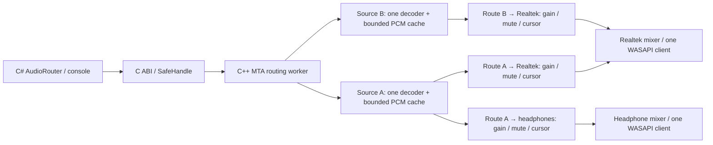

# Routing and mixing checkpoint

Validated on October 17, 2026, on Windows 11 x64, with Realtek speakers and
WH-1000XM6 Bluetooth headphones. This checkpoint adds many-to-many local-file
routing to the existing endpoint discovery, tone, and independent-player tools.

## Architecture



`AudioDecoder` uses Media Foundation to produce 48 kHz stereo float PCM. Each
source retains up to 192,000 frames (four seconds) in an indexed ring. Routes
read that shared cache independently; adding a destination does not duplicate
the decoder. The worker decodes on demand, without loading entire media files.

Each output continuously renders through one shared-mode, event-driven WASAPI
client. It sums connected, playing sources with their route gains, skips muted
contributions, and clamps samples after summing. Muted and zero-gain readers
continue advancing. Source play/pause/stop/seek controls affect all that source's
routes; route controls affect only one connection. Connections can be updated or
removed while unrelated playback continues.

The MTA worker owns all COM, decoding, and rendering resources. Synchronous
commands acknowledge completion before returning through the C ABI. C# owns the
native graph through `SafeRoutingHandle`; disposal wakes and joins the worker.
Capacity is eight sources, eight distinct outputs, and 64 connections per graph.

## Automated evidence

Debug and Release solution builds passed with warnings treated as errors. The
routing checks passed on the two actual outputs, including normalized WAV
decoding, fan-out, signal summing, route control isolation, and live graph edits.

Release measurements used quiet 330 Hz and 550 Hz generated WAV sources:

| Condition on Realtek | Submitted PCM RMS | Meaning |
| --- | ---: | --- |
| One source, gain 0.01 | 0.0014142 | Reference level. |
| Same source, gain 0.02 | 0.0028278 | Approximately twice the amplitude. |
| Its Realtek route muted | 0.0000000 | No contribution; headphone RMS remained 0.0014143. |
| Realtek route unmuted | 0.0028292 | Signal restored at its existing timeline. |
| Realtek route at gain zero | 0.0000000 | Silent contribution. |
| Two different-frequency sources, gain 0.02 each | 0.0039999 | Both signals contribute to the same mixer. |
| Second source muted | 0.0028273 | First signal remains. |
| Both source routes muted | 0.0000000 | Silence while output submission continues. |
| Final source removed | 0.0000000 | No stale source contribution. |

During fan-out, the single source decoded approximately 48,164 frames/second,
while both output readers advanced. The cache held 48,640 of its maximum 192,000
frames at that snapshot. Quiet checks recorded no clipping. These measurements
describe PCM submitted before Windows/device volume and processing.

Additional checks covered:

- The real C# ABI sizes (56/80/48 bytes) and every field offset.
- Missing/corrupt files, invalid values and IDs, failure isolation, monotonic
  IDs, repeated disposal, and calls after disposal.
- Connect upsert, disconnect, source/output removal, endpoint reopening, and
  continued submission on the surviving output.
- An unrouted source advancing without unnecessary decoding; a later route
  joining its current position.
- Pause freezing both source time and route cursor; paused and playing seeks;
  Stop resetting positions; EOF completion and Play-from-Ended restart.
- Production C++ mixing math with known sample values: weighted sums, zero
  gain, cancellation before final clipping, nonfinite sanitization, and metrics.
- 51 CLI assertions across Debug/Release, including 40 invalid-command cases,
  quoted Windows paths, EOF cleanup, native failure recovery, and help without
  the native DLL. That case runner was temporary.
- Existing tone ABI/argument/buffer checks and silent file-player conversion,
  transport, seek, EOF/restart, and lifetime regression checks.

## Repeat the checks

Build the solution for each configuration first. From the repository root:

```powershell
dotnet run --project tests/AudioHaus.RoutingChecks/AudioHaus.RoutingChecks.csproj -c Release

$speaker = '{0.0.0.00000000}.{d607b8e4-57c2-43f2-a0a8-80fb4a9e3fc7}'
$headphones = '{0.0.0.00000000}.{6657aafe-8f28-416c-839d-45d01af5aff7}'
dotnet run --project tests/AudioHaus.RoutingChecks/AudioHaus.RoutingChecks.csproj -c Debug -- --hardware --output-a $speaker --output-b $headphones
```

Default routing checks open no output streams. `--hardware` requires two distinct
active endpoints and plays quiet generated tones. IDs above belong to this PC;
obtain current IDs with diagnostics `list`. Exit codes are 0 for requested checks
passed, 1 for failure, and 2 for unavailable required hardware. Generated fixtures
remain in unique temporary folders; user music is read only.

From an x64 Visual Studio Developer Command Prompt, the deterministic math checks
need no output device:

```text
cl /nologo /std:c++20 /EHsc /W4 /WX /Fe:artifacts/RoutingMathChecks.exe /Fo:artifacts/RoutingMathChecks.obj tests/AudioHaus.RoutingMathChecks.cpp
artifacts\RoutingMathChecks.exe
```

## Listening checkpoint

The one-minute check uses the user's existing MP3 and M4A files, seeking HUMBLE.
to 15 seconds and In My head to 30 seconds. It uses these phases:

| Phase | Seconds | Realtek | WH-1000XM6 |
| --- | ---: | --- | --- |
| 1 | 15 | HUMBLE., gain 0.15 | HUMBLE., gain 0.15 |
| 2 | 8 | Silent | HUMBLE. continues |
| 3 | 12 | Both songs mixed, gain 0.15 each | HUMBLE. continues |
| 4 | 8 | In My head only | HUMBLE. continues |
| 5 | 8 | In My head, reduced to gain 0.05 | HUMBLE. continues |
| 6 | 8 | HUMBLE. restored; In My head muted | HUMBLE. continues |

The session closed successfully with exit code 0, no standard-error diagnostics,
and HRESULT `0x00000000` on both sources and outputs. Before Stop, Realtek had
submitted 2,809,548 frames and the headphones 2,809,056 frames. Both outputs
reported zero clipped samples. Stop reset both source positions and all route
cursors to zero; the source caches remained within the four-second limit.

The user confirmed the audible results of this routing-engine checkpoint:
HUMBLE. played on both outputs, both songs mixed on Realtek, and In My head
played alone and then quieter on Realtek while HUMBLE. continued unchanged on
the headphones. Fan-out, mixing, independent gain, and mute passed listening
acceptance on the Realtek/WH-1000XM6 setup.

## Boundaries and further validation

This section records the original local-file milestone. Application capture is
now covered by [ApplicationCaptureValidation.md](ApplicationCaptureValidation.md),
and adaptive correction, delay, buffering, and device recovery by
[TimingReliabilityValidation.md](TimingReliabilityValidation.md).

This milestone routes local files. Capturing YouTube, Spotify, or another
application as a source and building a desktop interface remain separate work.

Source clocks use QPC; physical outputs have their own clocks and buffering.
Readers falling outside the four-second history rejoin the source clock and
increment their rebase counters. There is no adaptive resampling or promise of
acoustic synchronization. Windows and Bluetooth queues can delay audible control
changes. Final clamping bounds samples but does not prevent audible distortion
when combined gains are excessive; monitor clipping and reduce gains.

The MVP performs decoding and graph commands on the render coordinator, so slow
media access or graph initialization can interrupt rendering. Longer endurance,
device-loss/reconnect, latency/drift measurement, and stress tests are further
validation steps. The tested setup contains one Realtek output and one Bluetooth
output; simultaneous operation of two Bluetooth outputs remains untested.
